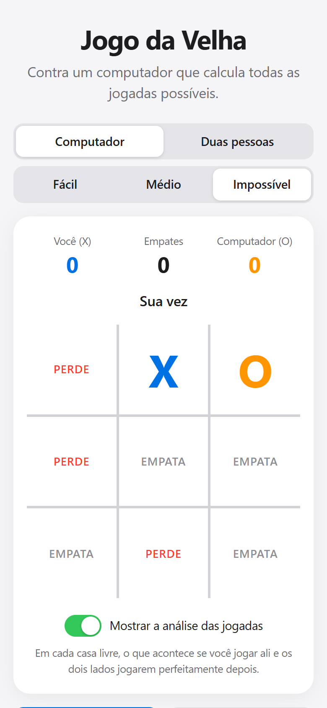

# Jogo da Velha

Jogo da velha contra um computador que usa o algoritmo minimax, com três níveis de dificuldade e uma análise que mostra o resultado de cada jogada possível.

**Acesse:** https://gutemberg-vercosa.github.io/jogo-da-velha/

<a href="https://gutemberg-vercosa.github.io/jogo-da-velha/"></a>

## O que ele faz

- Partidas contra o computador ou entre duas pessoas no mesmo aparelho.
- Três níveis:
  - **Fácil**: o computador joga em qualquer casa livre.
  - **Médio**: erra de propósito em 40% das jogadas.
  - **Impossível**: sempre joga o melhor; o máximo que dá para conseguir é empatar.
- **Análise das jogadas**: em cada casa livre aparece se aquela jogada leva a vitória, empate ou derrota, supondo que os dois lados joguem perfeitamente depois.
- Placar da sessão, e quem começa alterna a cada partida.
- Funciona no celular, com tema claro e escuro automático.

## Como o computador decide

O minimax simula, para cada casa livre, todas as partidas possíveis dali em diante. Ele supõe que o adversário também vai escolher o melhor para si e fica com a jogada que tem o melhor pior caso.

- O jogo da velha tem menos de 6 mil posições, então o cálculo completo leva milissegundos. Cada posição calculada é guardada (memoização) e não é refeita.
- Vencer mais cedo vale mais. Assim o computador fecha o jogo assim que pode e, se estiver perdendo, adia a derrota.
- Quando várias jogadas são igualmente boas, ele sorteia uma delas, para as partidas não serem sempre iguais.

Os testes jogam todas as sequências de jogadas possíveis contra o nível impossível, começando ou não, e confirmam que ele nunca perde.

## Tecnologias

- TypeScript e Vite, sem frameworks.
- Vitest para os testes das regras e da IA.
- GitHub Actions roda os testes, gera o build e publica no GitHub Pages a cada push.

## Estrutura

| Arquivo | Responsabilidade |
|---|---|
| `src/jogo.ts` | Regras e IA: vencedor, minimax, notas de cada casa e escolha da jogada por nível |
| `src/main.ts` | Interface: tabuleiro, placar, modos, níveis e análise |
| `src/style.css` | Layout mobile first, com tema claro e escuro |

## Rodando localmente

```bash
npm install
npm run dev    # servidor de desenvolvimento
npm test       # testes
npm run build  # build de produção em dist/
```
